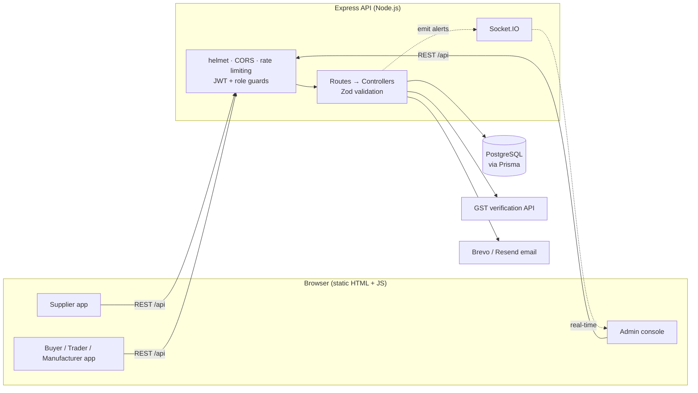
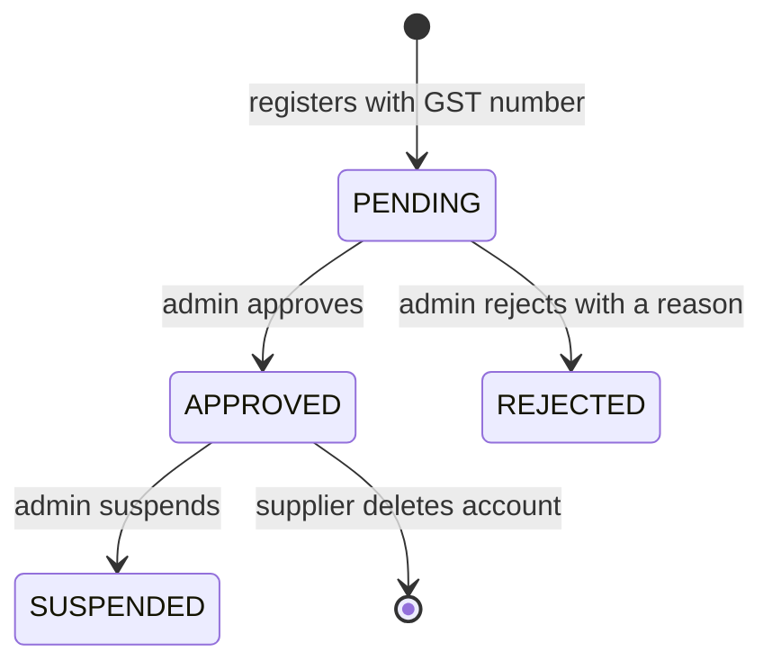
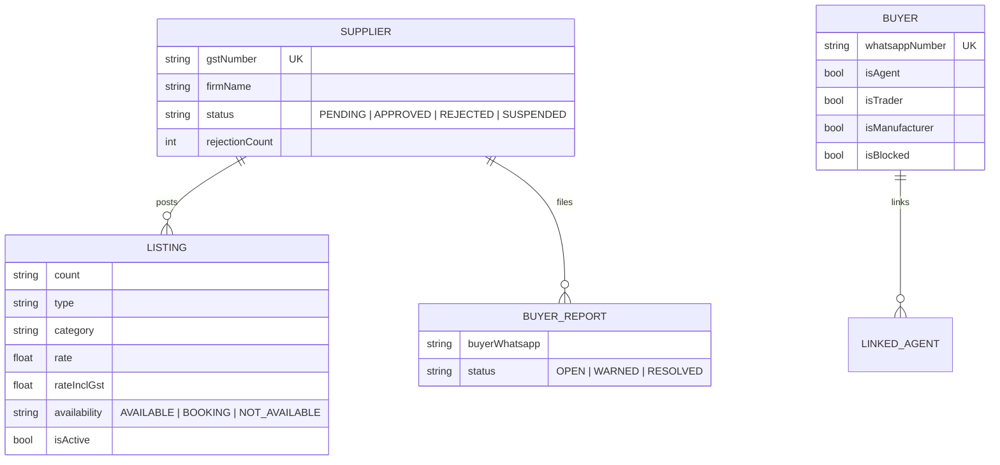

<div align="center">

# 🧶 YarnBazzar

### A trusted, daily-updated rate marketplace for India's yarn trade

Verified suppliers publish today's yarn rates. Buyers compare them in seconds. An admin keeps the market honest.


[The problem](#the-problem) · [Highlights](#highlights) · [How it works](#how-it-works) · [Engineering decisions](#engineering-decisions) · [Security](#security) · [API](#api-overview) · [Run it locally](#run-it-locally)

</div>

<!--
  Add these when you have them:
  - A live demo link under the badges
  - 3 screenshots (supplier dashboard, buyer search, admin panel) in a table here
-->

---

## The problem

Yarn rates in India change **every day**, and most of them travel as forwarded WhatsApp messages. Buyers can't compare mills side by side, can't tell whether a rate is from today or last week, and have no way to know whether the seller is even a real registered business.

## The solution

YarnBazzar replaces the forwards with a structured marketplace built around how the trade actually works:

- **Suppliers are verified.** A GST number is required and validated, and an admin must approve the firm before a single rate is visible.
- **Rates are daily.** Yesterday's listings are archived automatically, and buyers see today's rates first.
- **History is a click away.** Buyers can open any firm and see its last 30 days of rates instead of trusting a screenshot.
- **Bad actors get caught.** Suppliers can report abusive buyers, and the admin is alerted when the same buyer is reported by several different firms.

---

## Highlights

| | |
|---|---|
| **60+** REST endpoints | across 6 route groups: auth, supplier, buyer, trader, manufacturer, admin |
| **5** user roles | supplier, agent, trader, manufacturer, admin, each behind its own guard |
| **8** database models | PostgreSQL through Prisma, with indexes on the hot query paths |
| **Real-time** | Socket.IO pushes moderation alerts to the admin console |
| **IST-aware** | day boundaries, listing windows and supplier sessions all follow Indian Standard Time |
| **Zero-framework frontend** | 4,500 lines of plain HTML, CSS and JS served by the same Express app |

---

## How it works

### Architecture



### Supplier lifecycle



Only `APPROVED` suppliers can post listings, and only `APPROVED` suppliers' listings are ever shown to buyers.

### The daily rate cycle

1. A supplier posts today's rates (one request can create many listings at once).
2. The first post of a new day **archives all earlier listings** for that supplier, so stale prices never mix with fresh ones.
3. Buyers see **today's active listings** by default, and can pick any past date to see what the market looked like then.
4. Opening a firm shows its **last 30 days** of listings.

### Data model



Also in the schema: `Admin`, `DropdownOption` (admin-curated counts, types and categories) and `BlockedNumber`. Full definition in [`backend/prisma/schema.prisma`](backend/prisma/schema.prisma).

---

## Features

<details open>
<summary><b>🏭 Suppliers</b></summary>

- Register with a **GST number**: the format is validated, duplicates are rejected, and the firm's details are auto-filled from a GST lookup when an API key is configured (falling back to the state encoded in the GST number when it isn't)
- Post rates in bulk: count, type, category, yarn type, RPM, packaging, CSP, cone, availability and rate per kg. If you leave out the GST-inclusive rate, it's computed at 5%
- Custom dropdown values you type are added to the shared lists automatically
- Browse your own listing history by date, or reuse your last listing as a starting point
- Report abusive buyers; change WhatsApp number; delete your account (password-confirmed, soft delete)
</details>

<details open>
<summary><b>🛒 Buyers: agents, traders and manufacturers</b></summary>

- Search today's rates by count, type, category, yarn type, RPM, city or proprietor, with pagination
- Search firms by name, GST number, proprietor or city, and open a firm profile with its 30-day rate history
- Traders and manufacturers register with GST and office or factory addresses, and can **link agents** to their account
- Upgrade an agent account to trader or manufacturer later, or delete the agent profile
</details>

<details open>
<summary><b>🛡️ Admin</b></summary>

- Dashboard counts: suppliers by status, buyers, active listings, reports by status
- Approve, reject (with a reason), suspend or delete suppliers; correct firm names
- Block and unblock buyers; reset supplier and buyer passwords
- Work through buyer reports (`OPEN → WARNED → RESOLVED`)
- **Automatic alert** when one buyer is reported by **3 or more different suppliers**, pushed live over Socket.IO
- Curate the dropdown options used in listings
</details>

---

## Engineering decisions

The interesting part of this project is the small decisions behind the behaviour.

| Decision | Why |
|---|---|
| **Supplier sessions expire at midnight IST** (buyers: 30 days, admin: 7 days) | Rates are daily. A supplier who stays logged in shouldn't be able to keep editing yesterday's prices, and logging in each morning is a natural "post today's rates" prompt. |
| **Archive, don't delete, old listings** | Archived rows power the 30-day firm history and past-date search, and they keep an audit trail if a price is disputed. |
| **Date windows built in IST, not UTC** | IST midnight is 18:30 UTC the previous day. A naive `createdAt::date` comparison would put late-evening listings on the wrong day. |
| **GST lookup with a fallback chain** | The check goes format → duplicate on our platform → external GST API (5-second timeout) → state derived from the first two digits of the GSTIN. An outage or an expired API key degrades the feature instead of breaking registration. |
| **Report threshold counts *distinct suppliers*** | One angry supplier shouldn't be able to flag a buyer on their own. Three independent firms is a pattern. |
| **Everything under `/api/admin` is behind one guard** | `router.use(requireAdmin)` at the top of the router means a new admin route can't be added unprotected by accident. |
| **Duplicate and blocklist checks before account creation** | GST number, email and WhatsApp number are all unique, and numbers on the block list can't re-register. |

---

## Security

| Concern | What's in place |
|---|---|
| Password storage | bcrypt hashes |
| Authentication | JWT with role claims; separate lifetimes per role |
| Authorization | Per-route guards: `requireSupplier`, `requireBuyer`, `requireAdmin`, `requireSupplierOrAdmin` |
| Input validation | Zod schemas, including GST and Indian mobile number formats and role-specific required fields |
| Abuse protection | Global limiter (200 requests per 15 min) plus a stricter limiter on `/api/auth` (20 per 15 min) |
| HTTP hardening | `helmet`, CORS configuration, JSON body size cap |
| Password reset | Random 32-byte token, 1-hour expiry, cleared on use |
| Account deletion | Requires current password |

---

## API overview

| Prefix | Access | Highlights |
|---|---|---|
| `/api/auth` | public | supplier and buyer register and login, `GET /gst-lookup/:gst`, `POST /forgot-password`, `POST /reset-password`, `PUT /change-password` |
| `/api/supplier` | supplier | `GET/POST /listings`, `PATCH/DELETE /listings/:id`, `GET /listings/history`, `GET /listings/by-date`, `POST /report-buyer` |
| `/api/buyer` | buyer | `GET /listings` (filters and pagination), `GET /firms/search`, `GET /firms/:id`, `GET /firms/:id/history` |
| `/api/trader`, `/api/manufacturer` | buyer | `POST /upgrade`, `POST /agents`, `GET /agents`, `DELETE /agents/:agentId` |
| `/api/admin` | admin | supplier approve, reject and suspend; buyer block and unblock; reports; dropdown management; dashboard |
| `/api` (shared) | mixed | dropdown options, `location/states`, `location/districts/:state`, `location/cities/:state/:district` |

---

## Run it locally

**Prerequisites:** Node.js 18+ and a PostgreSQL database (local, or a free hosted one such as Neon).

```bash
git clone https://github.com/samarthmantri06-new/YarnBazzar.git
cd YarnBazzar/backend
npm install
cp .env.example .env          # fill in DATABASE_URL and JWT_SECRET at minimum
npx prisma generate
npx prisma db push            # create the tables
npm run db:seed               # optional demo data (development only)
npm run dev                   # http://localhost:5000
```

The Express server also serves the frontend, so open `http://localhost:5000` and you're in.

> ⚠️ `npm run db:seed` **wipes existing data** before inserting demo records. Never point it at a real database.

### Environment variables

| Variable | Required | Purpose |
|---|---|---|
| `DATABASE_URL` | ✅ | PostgreSQL connection string |
| `JWT_SECRET` | ✅ | Signing secret, use a long random string |
| `PORT` | | Defaults to `5000` |
| `JWT_SUPPLIER_EXPIRES` · `JWT_BUYER_EXPIRES` · `JWT_ADMIN_EXPIRES` | | Token lifetimes (defaults `1d` · `30d` · `7d`; suppliers also expire at midnight IST) |
| `GSTIN_API_KEY` | | Enables live GST lookup; without it the app falls back to the state code |
| `BREVO_API_KEY` + `EMAIL_USER` | for email in production | Password-reset emails via Brevo's HTTP API |
| `RESEND_API_KEY` + `EMAIL_FROM` | alternative | Resend instead of Brevo |
| `EMAIL_PASS` | local only | Gmail app password for SMTP in development |
| `CLIENT_SUPPLIER_URL` · `CLIENT_BUYER_URL` · `CLIENT_ADMIN_URL` | | Extra allowed origins for CORS and Socket.IO |

---

## Project structure

```
YarnBazzar/
├── backend/
│   ├── prisma/
│   │   ├── schema.prisma        # 8 models, indexes
│   │   ├── migrations/
│   │   └── seed.js              # demo data (dev only)
│   └── src/
│       ├── app.js               # middleware stack, routes, static frontend
│       ├── index.js             # HTTP server + Socket.IO
│       ├── routes/              # one router per role
│       ├── controllers/         # business logic
│       ├── middleware/auth.js   # JWT verification + role guards
│       ├── services/            # email delivery
│       ├── lib/                 # Prisma client, file helper
│       └── data/                # India states / districts / cities
└── frontend/                    # supplier, buyer and admin pages
```

---

## Known limitations and roadmap

Being straight about what isn't done yet:

- [ ] **Automated tests.** Auth, listing archival and the report threshold are the first targets, with CI to run them
- [ ] **Hash reset tokens at rest** and return identical responses for known and unknown accounts on the reset endpoint
- [ ] **Move uploaded images to object storage** (S3 or Cloudinary) instead of the app's disk and database
- [ ] **Price-trend charts** from each firm's 30-day history
- [ ] **WhatsApp click-to-chat** from a listing to the supplier

---

## Author

**Samarth Mantri** · B.Tech Information Technology, NIT Karnataka, Surathkal

[GitHub](https://github.com/samarthmantri06-new) · [LinkedIn](https://www.linkedin.com/in/samarth-mantri-615118330/)

<!-- Add a LICENSE file (MIT is fine) and link it here -->
